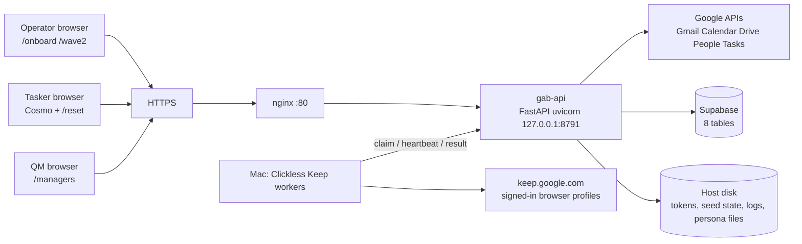

# Architecture

Source of truth: the code on branch `feat/wave2-keep-reset` (deployed 2026-11-24). File references are relative to the repo root.

## 1. Picture

## 2. Components

| Component | Where | Role |
|---|---|---|
| `gab-api` service | EC2 host, systemd, `uvicorn reset_service.app:app --workers 1` | All web pages and APIs; runs seeds and resets in background tasks |
| Classic pipeline | `seeder/materialize/` | Gmail / Calendar / Drive seeding for the classic personas (persona archives under `GAB_PERSONA_ROOT`) |
| Wave 2 pipeline | `seeder/wave2/` + `seeder/pilot10/gab_seed.py` | Gmail, Contacts, Calendar, Drive, Tasks for the 13 Wave 2 personas (`GAB_WAVE2_ROOT/<persona>/turn_1/turn_1_world.json`). On only when `GAB_WAVE2_ROOT` is set |
| Legacy engine | `engine/` (`gab-seed` CLI) | Used only when `GAB_CONFIG` is set; not used in production |
| Keep job queue | `api/reset_service/jobs.py`, `jobs_api.py`, tables `module_jobs`, `module_workers` | Keep has no API for these accounts; jobs are done by a browser worker |
| Clickless (Keep worker) | Electron + Camoufox app on a Mac (not in this repo) | Polls the queue, opens each account's signed-in browser profile, rewrites Keep to the persona's notes (keep-pack.json) |
| GAB Authorizer | Electron app (not in this repo) | Automates the authorize step on `/onboard`; also sets the Google profile name, home address, birthday |
| Supabase | Hosted Postgres via PostgREST (`db.py`) | Accounts, sessions, allow-lists, Keep jobs |

## 3. Flows

### 3.1 Authorize an account
- **Consumer `@gmail.com`** (per-account OAuth):
  1. Operator uploads a client.json on `/onboard` or `/wave2`. It is stored per browser session (cookie `gab_onboard_sid`, file `seeder/clients/<sid>.json`).
  2. **Authorize** → Google consent → `/oauth/callback` → token saved to `seeder/tokens/<email>.json` (it records its own `client_id`), `gab_accounts.authorized = true`.
  3. Scopes: openid, userinfo.email, `mail.google.com`, calendar, drive; Wave 2 personas add contacts and tasks (`seeder/materialize/auth.py`).
- **Workspace domains** (domain-wide delegation, DWD): a service-account key impersonates users; no per-account consent. Scopes `mail.google.com`, calendar, drive (`seeder/materialize/authbackend.py`); Wave 2 also needs contacts and tasks in the Admin-console grant (`seeder/wave2/creds.py`). The grant is all-or-nothing: one missing scope fails every token with `unauthorized_client`.
- Which path an account uses: `authbackend.backend_for` (consumer domain or saved token → OAuth; Workspace domain + key → DWD).

### 3.2 Seed (operator)
1. `POST /ui/seed` (from `/onboard` or `/wave2`) → mode decided (§4) → background task, capped by `SEED_CONCURRENCY`.
2. Wave 2 seed (`seeder/wave2/runner.py`): full wipe (calendars kept and reused) → Gmail → Contacts → Calendar → Drive → Tasks → delete security-alert mail → de-duplicate Drive → **baseline snapshot** (`_seed_state/`) → empty Gmail Trash/Spam and Drive Trash → verify counts against the persona.
3. Progress JSON per account under the Wave 2 state dir; pages poll `/ui/wave2/progress`.
4. `gab_accounts.last_reset_persona / last_reset_mode / last_reset_at` updated.
5. Keep is a separate job (§3.4), queued from `/wave2`.

### 3.3 Tasker reset (Cosmo)
1. Cosmo calls `POST /api/reset-link` (Bearer `RESET_API_KEY`) → URL `/reset#t=<token>`; the token is HMAC-signed with `RESET_LINK_SECRET` and carries email, persona, task id, session id; valid `RESET_LINK_TTL_S` (600 s). Cosmo's calls come from the tasker's browser, not a Cosmo server.
2. Tasker opens it → Google sign-in (identity only); email must be active in `freelancers` (gate on when `GAB_DEPLOY_MODE=ec2`).
3. Page asks **"Did this task use Google Keep?"** → `POST /ui/task/reset {token, include_keep}` (token single-use).
4. Reset runs (same persona → `reconcile`: delete what the tasker added, restore the baseline), capped by `RESET_CONCURRENCY`.
5. Keep job queued at once: **Yes** → mode `reseed`, linked to the reset; **No** → mode `check` (read-only, background, not linked).
6. Page polls `/ui/reset/{id}` and `/ui/reset/{id}/services`; the **Session ID** is shown only when the API reset is complete and Keep is done (or skipped for No).

### 3.4 Keep job (worker)
- States: queued → running → done / failed / needs_manual / cancelled (`jobs.py`).
- Worker: `POST /api/worker/claim` → heartbeats → `result` (Bearer `WORKER_API_KEY`; routes return 503 if unset). Lease `JOB_LEASE_S`.
- Priority: jobs linked to a reset are claimed first; bulk jobs step aside when a reset job is waiting.
- A reset-linked job running longer than `JOB_MAX_RUN_S` (default 480 s) is cancelled. Bulk jobs have no time cap.
- A job no live worker can take (account not on any worker's list) becomes `needs_manual` / NO_WORKER after `JOB_UNROUTABLE_AFTER_S` (600 s).
- The check of a finished job against the persona's notes: `api/reset_service/wave2_keep.py`.

## 4. Modes

| Mode | What it does | When it is chosen (`_decide_mode`, `api/reset_service/app.py`) |
|---|---|---|
| `upload` / `seed` | First seed of a fresh account | Account never seeded |
| `reconcile` | Delete items not in the baseline, restore missing/changed ones | Same persona as `last_reset_persona` (default for tasker resets) |
| `reseed` | Wipe everything, seed the persona again | Different persona, or no baseline |
| `delta` | Restore only (never deletes) | Only when asked explicitly |
| `clean` | Wipe everything, seed nothing (empty-universe accounts) | Blank persona or "no environment required" |
| Keep job modes | `reseed`, `clean`, `check` (read-only), `fullreseed` | Set by the caller (`jobs.py`) |

- One active operation per account (partial unique index on `reset_sessions`); a second request gets HTTP 409.
- On startup the service re-drives in-flight sessions (`_resume_inflight_sessions`, up to `MAX_RESUME_ATTEMPTS` = 3); a stuck-session reaper runs every `REAPER_INTERVAL_S`.

## 5. Data

### Supabase tables (`db/schema.sql`)
| Table | One row is |
|---|---|
| `gab_accounts` | An account: persona fields, `last_reset_*`, `persona_override`, `authorized` |
| `reset_sessions` | One seed/reset operation: status, mode, error |
| `freelancers` | An email allowed to sign in on `/reset` (`added_by` = QM) |
| `freelancer_managers` | A QM allowed to use `/managers` |
| `freelancer_blocklist` | An email no QM may add |
| `client_whitelist` | IP allow-list (feature off unless `CLIENT_WHITELIST_ENABLED`) |
| `module_jobs` | A Keep job (status, mode, events, follow-up, inventory) |
| `module_workers` | A Keep worker and the accounts it declares |

### Host disk
| Data | Location (setting) |
|---|---|
| OAuth tokens | `seeder/tokens/<email>.json` |
| Uploaded client.json files | `seeder/clients/<sid>.json` (per session), `seeder/credentials.json` (global) |
| DWD service-account key | `seeder/gab-sa.json` or `ENV_LOADER_SA_KEY` |
| Classic persona archives | `GAB_PERSONA_ROOT` |
| Wave 2 persona files | `GAB_WAVE2_ROOT` |
| Wave 2 baselines + progress | `GAB_WAVE2_STATE_DIR` (else `$GAB_STATE_DIR/wave2`) |
| Classic run folders | `seeder/runs/` (purged after 3 days by a cron on the host) |
| Per-account run logs | `GAB_LOGS_DIR` (`accounts/<email>/…`) |
| Activity logs | `ACTIVITY_LOG_DIR` (default `<repo>/logs`): `events-<date>.jsonl`, `summary.log`, `errors.log` |
| QC logs / job screenshots | `RESET_LOG_DIR` / `JOB_FILES_DIR` |

## 6. Access control

| Surface | Protection |
|---|---|
| `/api/*` (Cosmo, admin) | Bearer `RESET_API_KEY` (`GET /api/environment/reset/{id}` is open) |
| `/reset` | Signed link + Google sign-in against `freelancers` |
| `/managers` | Google sign-in against `freelancer_managers` |
| `/api/worker/*` | Bearer `WORKER_API_KEY` |
| `/onboard`, `/wave2`, `/logins`, `/qc` and their `/ui/*` calls | Operator-only. How they are protected is recorded in the private handover sheet. |

## 7. Settings (names only; values live in the host's `.env`)
- **Service:** `PUBLIC_BASE_URL`, `GAB_DEPLOY_MODE`, `CORS_ALLOW_ORIGINS`, `GAB_THREAD_POOL`, `GOOGLE_CLIENT_ID` (tasker/QM sign-in)
- **Keys/secrets:** `RESET_API_KEY`, `WORKER_API_KEY`, `RESET_LINK_SECRET`, `SUPABASE_KEY`
- **Supabase:** `SUPABASE_URL`, `SUPABASE_TABLE`, `SUPABASE_ACCOUNTS_TABLE` (+ optional table-name overrides)
- **Throughput:** `SEED_CONCURRENCY`, `RESET_CONCURRENCY`, `CALENDAR_RATE`, `CALENDAR_ACCOUNT_RATE`, `CALENDAR_WORKERS`, `DRIVE_RATE`
- **Timeouts:** `GAB_RESET_TIMEOUT_S`, `GAB_HTTP_TIMEOUT`, `RESET_LINK_TTL_S`, `JOB_LEASE_S`, `JOB_MAX_RUN_S`, `JOB_UNROUTABLE_AFTER_S`
- **Paths:** `GAB_STATE_DIR`, `GAB_LOGS_DIR`, `RESET_LOG_DIR`, `GAB_PERSONA_ROOT`, `GAB_WAVE2_ROOT`, `GAB_WAVE2_STATE_DIR`, `JOB_FILES_DIR`, `SEEDER_DIR`
- **Behaviour:** `GAB_RESET_MODE`, `GAB_RESET_SIMULATE`, `LOG_RETENTION_DAYS`
- Full list with defaults: `api/reset_service/config.py`.

## 8. Related systems (outside this repo)

| System | What it is |
|---|---|
| Cosmo (cosmo.deccanexperts.ai) | Tasking platform; gives taskers the reset link, collects the Session ID |
| Clickless | Keep worker app (Mac). Snapshot of the patched runtime: `automation/keep-automation.zip` (team drive) |
| GAB Authorizer | Authorize + Google-profile automation app (Mac) |
| GAB-Bot "Gigi" (github.com/deccanai-org/GAB-Bot) | Discord/Slack FAQ bot for taskers; answers from approved FAQ files; Qwen model; deployed to EKS via Jenkins |
| Siddhi pipeline | Metabase export → sheet → CSV packaging steps (Drive folder "Siddhi pipeline instructions") |
